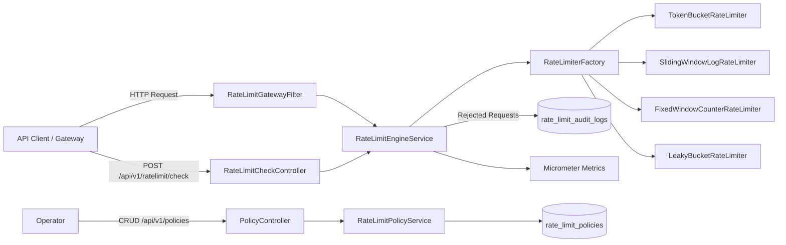

# Aegis Rate Limiter & Quota Engine

[](https://github.com/MickaelGeronimo/aegis-rate-limiter/actions/workflows/ci.yml)


A multi-tenant API rate-limiting and quota enforcement service built with **Java 17**, **Spring Boot 3**, **Spring Data JPA**, **Flyway**, and **Micrometer**. Implements four thread-safe throttling algorithms behind a unified enforcement API, HTTP gateway filter, RFC 7807 `ProblemDetail` errors, and audit logging.

---

## Architecture



---

## Supported Algorithms

| Algorithm | Enum Key | Burst Handling | Memory Profile | Best Use Case |
|---|---|---|---|---|
| **Token Bucket** | `TOKEN_BUCKET` | Allows controlled bursts up to `capacity` | $O(1)$ per key | Public APIs allowing short traffic spikes with steady refill |
| **Sliding Window Log** | `SLIDING_WINDOW_LOG` | Strict rolling limit, no boundary burst | $O(N)$ timestamps | Sensitive endpoints (login, OTP, payments) |
| **Fixed Window Counter** | `FIXED_WINDOW_COUNTER` | Resets at fixed window boundaries | $O(1)$ per key | High-throughput telemetry and coarse quotas |
| **Leaky Bucket** | `LEAKY_BUCKET` | Smooths traffic at a constant drain rate | $O(1)$ per key | Downstream protection requiring steady outflow |

---

## Key Engineering Highlights

- **Deterministic Time Abstraction (`TimeSource`)**: Core algorithms depend on a monotonic nanosecond `TimeSource` rather than wall-clock sleep calls, enabling fast, zero-flakiness unit and 16-thread concurrency tests.
- **Dynamic Policy Fingerprinting**: Active limiter buckets in `RateLimitEngineService` track each policy's configuration fingerprint; updating a policy via `PUT /api/v1/policies/{id}` replaces stale buckets transparently on the next check.
- **Standard HTTP Headers**: Responses include `X-RateLimit-Limit`, `X-RateLimit-Remaining`, `X-RateLimit-Reset`, `X-RateLimit-Algorithm`, and `Retry-After` on `429 Too Many Requests`.
- **Persistence & Migrations**: Flyway (`V1__create_rate_limit_tables.sql`) manages `rate_limit_policies` and `rate_limit_audit_logs` on both H2 (PostgreSQL mode) and PostgreSQL 16.
- **Observability**: Emits `aegis.ratelimit.decisions` counters tagged by `tenant`, `algorithm`, and `outcome` via Actuator (`/actuator/metrics`, `/actuator/prometheus`).

---

## Quick Start

### Run Locally (Embedded H2 in PostgreSQL Mode)

```bash
mvn spring-boot:run
```

Swagger UI is available at `http://localhost:8080/swagger-ui.html`.

### Run with Docker Compose & PostgreSQL 16

```bash
docker compose up --build
```

### Run Full Verification Suite

```bash
mvn -B clean verify
```

---

## API Usage Examples

### 1. Create a Rate-Limit Policy

```bash
curl -X POST http://localhost:8080/api/v1/policies \
  -H "Content-Type: application/json" \
  -d '{
    "tenantId": "fintech-prod",
    "routePattern": "/transfers",
    "algorithm": "SLIDING_WINDOW_LOG",
    "capacity": 5,
    "refillTokens": 5,
    "windowSeconds": 60,
    "enabled": true
  }'
```

### 2. Evaluate Quota Enforcement

```bash
curl -i -X POST http://localhost:8080/api/v1/ratelimit/check \
  -H "Content-Type: application/json" \
  -d '{
    "tenantId": "fintech-prod",
    "routePath": "/transfers",
    "clientKey": "user-123",
    "permits": 1
  }'
```

### 3. Test the Live HTTP Gateway Filter

```bash
curl -i http://localhost:8080/api/v1/demo/ping \
  -H "X-Tenant-Id: fintech-prod" \
  -H "X-Client-Key: user-123"
```

### 4. Inspect Blocked Request Audit Logs

```bash
curl "http://localhost:8080/api/v1/audit?tenantId=fintech-prod"
```
